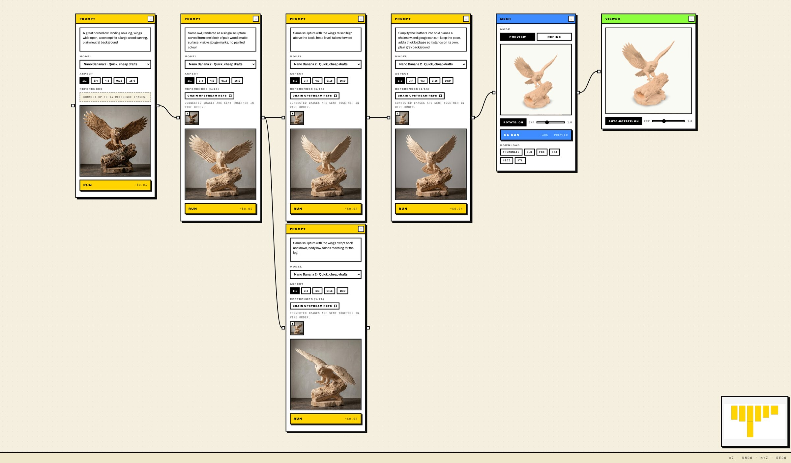

# Carvingen

A node canvas for AI image, video and 3D generation. It was built for wood-carving studios: a concept goes from a first image to a 3D model, and the carvers put on 3D glasses, look at the model from every side and carve from it. Studios in Kentucky and Missouri work this way.

It is not only for carvers. Anyone who wants to branch an idea, keep every version and end up with a 3D model can use it.



*One real run: a first image, an edit, two branches, a simplified version, then a Meshy v6 model in the Viewer. The workflow is in [`examples/workflows/owl-landing.json`](examples/workflows/owl-landing.json).*

## Why a canvas

The first pieces were made by hand: prompts in a chat, images saved in folders, a separate tool for the 3D model. A chat is linear, so you lose which image came from which. On the canvas every prompt is a node, every image hangs off the one it came from, and nothing is thrown away. You can branch, go back, compare siblings and carry any image forward as a reference. It is a node workflow in the way ComfyUI is, built to take a concept all the way to a 3D model.

## What is in it

- **Nodes:** Image, Prompt, Vision, Video, Mesh and Viewer. Up to 14 reference images on Nano Banana 2. Every run stays in the node's history. Undo and redo cover every change to the graph.
- **Models, all through [fal](https://fal.ai):** Flux Kontext Pro, Nano Banana 2 and Pro, GPT Image 2, Veo 3.1, Seedance, Meshy v6 and Hunyuan 3D.
- **3D:** GLB, FBX, USDZ, OBJ and STL downloads, and a model viewer.
- **Scripts:** run a whole canvas from JSON (`pnpm workflow`), and batch characters through multi-view, Meshy rigging and animation, and packing for games (`pnpm characters`, `pnpm character:pack`). See [`docs/WORKFLOW_JSON.md`](docs/WORKFLOW_JSON.md).
- **Stack:** Next.js 16, React 19, React Flow, Valtio, TanStack Query, SQLite with Drizzle, and a local folder for generated assets.

## Run it

```bash
pnpm install
pnpm dev:local
```

Open http://localhost:3001. Generation needs a `FAL_KEY` in a local `.env.local`; every Run spends money on fal, and the cost of each Run is shown on its button. Local state defaults to `./carvingen.sqlite` and `./outputs/`, both git-ignored.

For local development with generation, also set:

```bash
FAL_PROXY_ALLOW_UNAUTHENTICATED=true
MAX_REMOTE_ASSET_BYTES=104857600
REMOTE_ASSET_ALLOWED_HOSTS=fal.media,v2.fal.media,v3.fal.media,storage.googleapis.com,cdn.meshy.ai,assets.meshy.ai
```

Keep `FAL_PROXY_ALLOW_UNAUTHENTICATED=false` on anything deployed. The fal proxy only forwards the image, mesh, video and vision endpoints Carvingen uses, and saved assets must come from the allowed hosts, with matching types and bounded sizes.

## Try the owl workflow

```bash
pnpm workflow examples/workflows/owl-landing.json --dry-run
pnpm workflow examples/workflows/owl-landing.json --base-url http://127.0.0.1:3001 --fal-storage-inputs
```

The dry run checks the graph and calls nothing. The real run makes five images and one 3D model on fal, which costs a few dollars.

## Checks

```bash
pnpm exec tsc --noEmit
pnpm lint
pnpm test
pnpm build
```

`/portfolio-demo` is a read-only page with fixture data and no provider calls, for showing the layout without spending anything.
